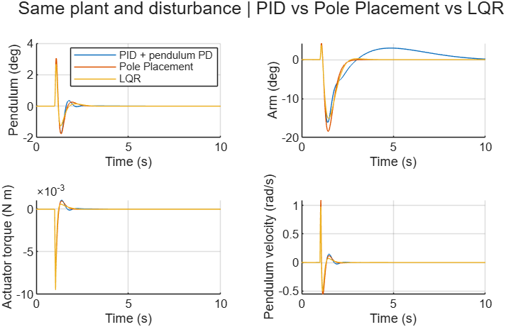

# Furuta Pendulum | Modern Control

**CAD design, nonlinear modelling and controller comparison - Weeks 6 & 9, Fall 2026.**

A rotary inverted pendulum study combining mechanical CAD with MATLAB and Simscape Multibody. The workflow derives the equations of motion, linearizes the system near the upright equilibrium, and compares PID, pole placement and LQR under torque disturbances.

> **Project status:** simulation study. Saved results are supplied for reference; current hardware performance and full reproducibility on another computer remain to be verified. See [reproducibility notes](docs/REPRODUCIBILITY.md).

## Project structure

```text
cad/
  inventor/original/              Native Inventor project and dependencies
  solidworks/simplified_assembly/ Assembly and simplified rigid groups
  step_exchange/                 Neutral CAD exchange files
simulation/
  Furuta_Project/
    *.mlx                        Nine Live Scripts
    models/                      Current study and validation models
    geometry/                    Required STEP geometry
    data/                        Physical parameters and controller data
    results/                     Saved tables, plots and simulation records
    archive/                     Earlier saved model
docs/                            Project and controller reports, drawings
electrical/                      Component selection and wiring guide
archive/                         Earlier repository notes
```

The CAD and simulation folders are separated. Geometry is also retained inside the MATLAB package so its model-relative references remain usable after downloading.

## Run the simulation

1. Download the repository using **Code > Download ZIP**, or clone it. Extract the complete folder tree.
2. Open **MATLAB R2026a** and set Current Folder to `simulation/Furuta_Project`.
3. Open `models/Furuta_StudyF.slx`. This is the current controller study; `.slxc` files are generated caches and are not models.
4. Review the controller selector, disturbance configuration and initial conditions, then save the model before running scripted tests.
5. Run the core Live Scripts in the following order. The first two can regenerate the model data; do not rerun them over changed physical assumptions without reviewing those assumptions.

| Order | Live Script | Purpose |
|---|---|---|
| 1 | `Furuta_Mathematical_Model.mlx` | Nonlinear equations and comparison with the validation plant |
| 2 | `Furuta_State_Space.mlx` | Equilibria, A/B/C/D, eigenvalues, controllability and observability |
| 3 | `Furuta_PID.mlx` | PID / pendulum PD implementation and response metrics |
| 4 | `Furuta_Pole_Placement.mlx` | State-feedback design and simulation |
| 5 | `Furuta_LQR.mlx` | Quadratic-cost design and simulation |
| 6 | `Furuta_Comparison.mlx` | Compare saved controller results |

Additional studies:

| Live Script | Purpose |
|---|---|
| `Furuta_Submission_Notes.mlx` | Assumptions, design justification and nominal tests |
| `Furuta_Controller_Tuning.mlx` | Candidate gains, linear screening and optional nonlinear checks |
| `Furuta_Pulse_Tests.mlx` | Ten signed pulse cases for each controller |

Local functions belong at the end of their Live Script. Use **Run All** to execute the main sections that call them. Optional nonlinear tuning is controlled by `run_nonlinear_checks`; candidate gains do not automatically replace accepted gains.

### Software requirements

- MATLAB R2026a and Simulink
- Simscape and Simscape Multibody
- Control System Toolbox
- Symbolic Math Toolbox when regenerating symbolic modelling / linearization sections
- Autodesk Inventor or SolidWorks for native CAD editing; STEP files are provided for exchange

## CAD and model import

Start with the Inventor project file under `cad/inventor/original`. Preserve its dependency directories when opening assemblies. Simplified SolidWorks and STEP exports are provided separately. The CAD-to-MATLAB workflow used XML/STEP import, not URDF. See the reproducibility notes for the available import artifacts and portability limits.

## Results and interpretation

Controller plots and tables are under [`simulation/Furuta_Project/results`](simulation/Furuta_Project/results). Compare peak angles, settling time, pendulum IAE, RMS/peak torque and saturation under identical tests. No single ranking applies to every choice of performance weights or disturbance.



This figure is a saved result, not evidence of a fresh run of the packaged model. In particular, pulse-sweep evidence includes mixed historical outputs and must be regenerated before relying on it. No hardware suitability claim follows from an ideal torque-actuated simulation alone.

## Reports and electrical design

- [`docs/`](docs/): project report, modelling derivation, individual controller reports and CAD drawings.
- [`electrical/`](electrical/): component workbook and wiring guide. Verify component revisions, encoder interfaces and the exact motor datasheet before hardware assembly.
- [`docs/REPRODUCIBILITY.md`](docs/REPRODUCIBILITY.md): packaging changes, evidence limits and rerun instructions.

## Next steps

Confirm measured masses and inertias; identify friction and motor/gearbox parameters; include voltage/current/torque limits and sampling effects; repeat disturbance tests; then validate the controller on hardware. Use measured hardware data to calibrate the simulation before describing it as a validated digital twin.

## Team

| Member | Student ID |
|---|---|
| Mohamed Mahmoud Basyouni | 23p0358 |
| Ahmed Tamer Abdelmonem | 23P0345 |
| Youssef Mohamed Soliman | 23P0318 |
| Youssef Gerges Ayad Klopp | 23P0413 |
| Makarious Safa Malky | 2300607 |
| Micheal Hany Shawky | 23P0409 |
| Paula Adel Harby | 23P0405 |
| Islam Amir | 23p0348 |

## File management

Required models, parameter data, geometry and selected result files are versioned. Simulink caches, CAD locks and automatic backups are excluded. No project license has been assigned here; third-party CAD components and manufacturer documents retain their original rights.
